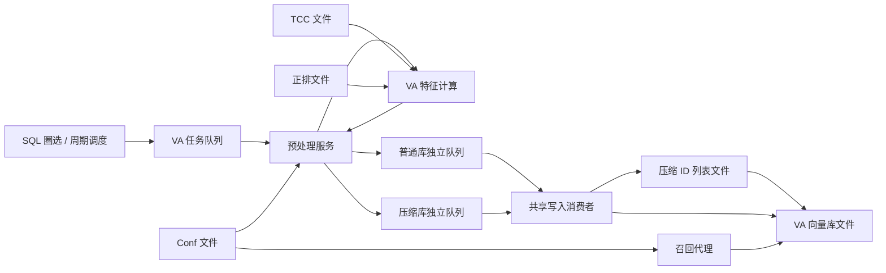

# VA 向量索引模拟环境

本项目作为基础工程题 **TB-MY-001 / v1** 存档。交给模型时使用 [完整任务 prompt](docs/AGENT_PROMPT.md)，并遵守 [模型访问规则](AGENTS.md)：可以阅读业务背景与代码，禁止查看验证器源码和评测内部材料。原始问题的版本标识、恢复及新建解题分支方法见 [基线存档说明](docs/BASELINE_ARCHIVE.md)。

题目入口：[TB-MY-001 · Issue #1](https://github.com/YuxiangLiu-lyx/TB3/issues/1)。原始代码与 prompt 固定在 [基线提交 50df5c3](https://github.com/YuxiangLiu-lyx/TB3/commit/50df5c327647ecbe297ddf6c89342c41805415db)，对应标签 `problems/tb-my-001/v1`；后续解题从该版本新建工作分支。

这是用于工程改造和 AI 能力评测的模拟环境。默认提供完整 VA 写入、压缩索引和召回链路，另提供地区隔离、服务部署约束和 Mirror。具体 MY 计算、压缩处理及迁移链路留作后续工程题。

Python 3.11+，仅使用标准库，不需要安装依赖或启动外部服务。文件锁使用 `fcntl`，支持 macOS / Linux。以下命令均在仓库根目录执行。

完整的接口参数、消息契约、模块依赖和调用规则见 [接口与模块调用说明](docs/INTERFACES.md)。

队列如何绑定消费者、怎样插入中转服务、地区隔离及逐跳 Mirror 示例见 [消费链路与地区机制](docs/TOPOLOGY_AND_REGIONS.md)。

用于交给被测 AI 的独立工程题见 [接通 MY 写入与召回链路](docs/MY_MIGRATION_TASK.md)，其中说明了实现目标、地区约束、允许修改范围和配置新增索引的公开契约。

## 队列驱动与地区机制

每个队列在 `queues.json` 中通过 `bindings` 绑定一个消费者，消费者的 `service` 决定实际执行代码。预处理按 `outputs` 显式发布下一条消息，`forwarder` 按 `output_queue` 转发。运行时不会根据消息类型补齐业务流程；缺少输出路由时报错，禁用消费者时消息保持 pending。

```bash
python3 -m va_index topology
python3 -m va_index --cluster deployments/cluster.json --state-dir state/regions init
python3 -m va_index --cluster deployments/cluster.json --state-dir state/regions topology
```

Cluster 为每个地区建立独立配置和状态。普通服务只能使用本地资源，特征计算、正排和压缩辅助服务仅部署于 VA。跨地区消息由绑定到队列的 Mirror 消费者原样复制，不会改写物理库名称、压缩列表或向量。示例 MY SQL 入口明确返回“链路未配置”，便于后续测试工程改造能力。

原有服务默认全部归属 `va`。Runtime、配置读取器、Broker、调度、预处理、特征计算、写入、压缩辅助、向量库和召回代理均公开只读 `region`，创建后不会随配置客户端的替换而改变。`topology` 同时列出各组件的 `region`、`available` 和队列消费者的地区。

地区限制在服务调用和资源访问时执行。违规读取远端 Conf/TCC、调用远端特征/向量库、直接使用远端 Broker 或指向其他地区的状态目录，会立即抛出 `SimulationError`；发生在消费过程中则生成 failed 消息，并由同步入口返回 `status: failed` 和具体错误。整个过程不依赖验证器。可执行故障示例见 [地区隔离](docs/TOPOLOGY_AND_REGIONS.md#3-地区隔离)。

## 快速运行

```bash
python3 -m va_index demo
python3 -m va_index verify
python3 -m unittest discover -v
```

`demo` 初始化 `state/`，执行真实 SQL 圈选，提交并处理任务，最后输出各库记录数和压缩索引召回结果。首次运行应得到：

| corpusID | 物理库 | 类型 | 记录数 |
|---|---|---|---|
| 101 | `va_vectors_image_1001` | 普通图片索引 | 3 |
| 102 | `va_vectors_image_comp_2002` | 压缩图片索引 | 2 |
| 103 | `va_vectors_image_comp_shadow_3003` | 另一份压缩图片索引 | 2 |
| 104 | `va_vectors_text_4004` | 普通文本索引 | 3 |

`p1`、`p2` 的图片正排内容相同，因此得到相同向量，两个压缩库分别保存 `hash_id → ["p1", "p2"]`。普通库仍保存两个业务 ID。两个压缩库的 ID 列表各自独立。

`init` 和 `demo` 都保留已有状态。需要全新实验时，指定另一个状态目录：

```bash
python3 -m va_index --state-dir /tmp/va-experiment-001 demo
```

## 直接写入与返回错误

`write` 和 `send` 默认等待消息被实际消费后再返回。队列名必须在配置中存在；消费者会检查消息格式、路由和向量维度，流程中的 Conf、TCC、正排和存储仍实际读取文件。

```bash
python3 -m va_index init

# SQL 圈选 → 任务队列 → 特征计算 → 专属写入队列 → 实际落盘
python3 -m va_index write --dataset image_normal_only --mode forward \
  --sql "SELECT id FROM business WHERE id = 'p1'"

# 直接投递一条任务消息，消费者继续执行特征计算和写入
python3 -m va_index send --queue va.tasks --kind task \
  --payload-file cases/messages/text_task.json

# 直接向物理库专属队列投递带向量的写入消息
python3 -m va_index send --queue va.write.image_comp_shadow --kind write \
  --payload-file cases/messages/shadow_a.json

# 召回实际存在的记录，同时返回向量，方便与落盘数据对照
python3 -m va_index recall --corpus-id 103 \
  --embedding '[0,0,0,0,0,0,0,0]' --return-attr --return-embedding
```

消费完成时返回 `status: "done"`，`writes` 列出实际消费者返回的 Namespace、物理库、最终记录 ID 和原始业务 ID。下游写入失败会返回 `status: "failed"` 和具体 `errors`，即使前面的预处理已完成也不会报告整条链路成功。队列不存在或配置无法读取时直接返回 `error`。命令失败的退出码为 1。

可以直接传 JSON，以下两条命令分别触发“不存在的队列”和“消息字段缺失”错误：

```bash
python3 -m va_index send --queue missing.queue --kind write --payload '{}'
python3 -m va_index send --queue va.write.image --kind write --payload '{"id":"bad"}'
```

需要观察中间队列时，使用 `send --enqueue-only` 或原有的 `submit`，再执行 `process`。同步入口会按正常消费顺序推进已有积压；返回的完成回执仅关联本次投递及它产生的下游消息。`--limit` 限制一次消费数量，达到上限仍未完成时返回 `status: "pending"` 和非零退出码，后续可继续 `process`。多个目标的写入不是事务，部分失败前完成的写入仍会保留。

## 验证 case 和验证器

默认验证器按**请求是否成功且结果符合预期**判定。链路抛异常、消费者失败、消息仍 pending、返回完成但没有落盘、召回了目标库中不存在的记录，都会得到 `passed: false` 和退出码 1。

提供两个可直接运行的示例：

```bash
# 正确 case：SQL/消息写入、四个索引召回，passed: true，退出码 0
python3 -m va_index verify --cases cases/correct_request.json

# 错误请求 case：写入消息缺少字段，passed: false，退出码 1
python3 -m va_index verify --cases cases/invalid_request.json
```

不传 `--cases` 默认运行 [correct_request.json](cases/correct_request.json)。它先用 SQL 写入两个普通索引和两个压缩索引，再直接投递任务消息和写入消息，最后逐个召回四个库。[invalid_request.json](cases/invalid_request.json) 将错误消息送入已注册队列，由真实消费者报错；它的失败是示例的预期展示，但验证器仍将这个请求判为失败。

验证器为每个 case 创建全新状态目录和配置副本，保存在 `state/verification/<run-id>/<case-id>/`。同一 case 的请求共享状态、逐条执行和验证；某一步失败即停止该 case，其他 case 继续执行。报告路径通过 `report_path` 返回，包含每一步的输入、实际响应、存储证据和错误原因。原业务状态和配置保持不变。

验证规则：

- 写入必须完成。根据请求和 Conf 确定目标库，直接读取向量文件，确认业务 ID 已存在；压缩记录通过 Attr 核对原始业务 ID。
- SQL 使用入口圈选得到的 ID，可用 `expected_ids` 额外约束圈选结果；任务消息使用 payload.ids，直接写入使用 payload.id 和 db_list。
- 直接写入还核对提供的向量确实落盘，普通 Attr 一致；其他库的数据不应变化。
- 召回结果必须来自请求指定的地区、Namespace 和物理库。每个返回 ID、向量及 Attr 都与召回前的存储一致，不能重复或超过 top_k。
- 空库召回和 SQL 空选集可以通过；有数据却召回空结果判失败。不检查具体排序、分数、模型算法或哈希文本。

schema 2 的 case 还可声明 `expect_storage`，在所有请求完成后检查各库完整的业务 ID 集合、记录数和原始 ID 分组，用于检查压缩合并、重复写入及串库；不需要指定哈希 ID。格式见 [验证器接口](docs/INTERFACES.md#8-验证器调用与-case-扩展)。

`verify_request(runtime, request)` 可在现有状态上执行并验证单个请求，返回 `passed`、`response`、`evidence` 或 `error`。它不会自动补发消息、调用 Writer 修复链路或隐式追加召回；详细参数和 Python 示例见 [验证器接口](docs/INTERFACES.md#8-验证器调用与-case-扩展)。

使用 `--cluster deployments/cluster.json` 时会复制各地区配置并连接原有 Mirror 机制，按地区检查存储。请求可以指定 `region`；这不会补齐留作评测的 MY 迁移链路。

原有 [cases/va_cases.json](cases/va_cases.json) 保留为 schema 1 的系统回归验收，含以下四个正向 case，以及六个“系统应当拒绝错误输入”的负向测试：

| Case | 索引 | 专属写入队列 | 输入方式 | 业务数据 → 向量记录 |
|---|---|---|---|---|
| `normal_image_sql` | 101，普通图片 | `va.write.image` | SQL，Dataset `image_normal_only` | p1、p3 → 2 条 |
| `normal_text_task_queue` | 104，普通文本 | `va.write.text` | 任务消息投到 `va.tasks`，Dataset `text_only` | p2、p4 → 2 条 |
| `compressed_image_sql` | 102，压缩图片 | `va.write.image_comp` | SQL，Dataset `image_compressed_only` | p1、p2、p3 → 2 条 |
| `compressed_shadow_write_queue` | 103，压缩影子库 | `va.write.image_comp_shadow` | 两条写入消息直接投专属队列 | shadow-a、shadow-b → 1 条 |

这六项覆盖不存在的队列、错误消息格式、投错队列、缺失 TCC 文件、不存在的 corpusID 和错误召回维度。它们的 `expect_error: true` 表示检查系统是否正确拒绝请求；报错时回归测试通过。这与 schema 2 的请求结果判定语义不同。

```bash
# 运行旧版 10 项系统回归验收
python3 -m va_index verify --cases cases/va_cases.json

# 只运行指定 case
python3 -m va_index verify --cases cases/va_cases.json --case compressed_shadow_write_queue
```

测试覆盖消费者不发布下游消息、写入接口空操作、消费者停用、更新丢失、召回不存在的 ID / 错误向量 / 重复记录，以及 Mirror 后的目标地区落盘，确认验证器能发现错误。

## 实际执行和模拟边界

| 组件 | 行为 |
|---|---|
| SQL 圈选 | 实际查询本地 SQLite 的 `business` 表，只读执行，结果必须有唯一的 `id` 列；去重后提交 |
| Conf | 实际读取 `config/conf.json`，包含索引身份、Feature、压缩模式和 Dataset 绑定 |
| TCC | 实际读取 `config/tcc.json`，包含 VA Namespace、Feature 参数和召回默认参数 |
| 消息队列 | 按 `config/queues.json` 路由；每个物理库一个文件队列，独立积压、完成和失败记录 |
| 特征计算 | 返回可重复的模拟向量；实时模式使用业务 ID，正排模式实际读取 `state/forward.json` |
| 压缩辅助存储 | 实际读写 `state/compressed/`；以完整物理库名和向量哈希联合定位 ID 列表 |
| 底层向量库 | 实际持久化写入参数和向量记录到 `state/vectors/`，支持 upsert |
| 在线召回 | 根据 corpusID 实际读取 Conf、定位物理库；从已写入记录中按 ID 取前 K 条，分数为模拟值 |
| 周期任务 | 实际读取 `config/jobs.json`，保存调度进度，支持单次和固定间隔任务 |

服务通过 Python 接口和序列化后的队列消息交互，没有真实 RPC、模型推理、ANN 检索或云资源。结果中的 `mock_scores: true` 表示召回分数不代表向量相似度。



## 分步操作

初始化后，业务表字段为 `id TEXT PRIMARY KEY, category TEXT, active INTEGER`。示例数据来自 `fixtures/business.json`，正排数据来自 `fixtures/forward.json`；初始化只复制一次，之后实际使用 `state/` 中的数据。

```bash
python3 -m va_index init
python3 -m va_index validate

# 提交任务，只产生任务消息
python3 -m va_index submit --dataset products --mode forward \
  --sql "SELECT id FROM business WHERE active = 1 ORDER BY id"

# 仅执行预处理，生成各物理库的写入消息
python3 -m va_index process --stage preprocess
python3 -m va_index queues
python3 -m va_index queues --queue va.write.image_comp --status pending

# 只消费一个物理库；其他索引队列保持积压
python3 -m va_index process --stage write --queue va.write.image_comp

# 处理其余消息；默认每次最多处理 10000 条，可用 --limit 修改
python3 -m va_index process
python3 -m va_index dump

# corpusID 102 对应 8 维图片 Feature
python3 -m va_index recall --corpus-id 102 \
  --embedding '[0,0,0,0,0,0,0,0]' --top-k 3 --return-attr

# 单独调用特征服务
python3 -m va_index feature --id p1 --feature image_embedding --mode realtime
python3 -m va_index feature --id p1 --feature image_embedding --mode forward
```

失败消息移至所属队列的 `failed/`，包含原消息和 `error`；其他队列继续消费。`process` 本次发生失败时返回非零退出码。修复配置、正排或存储故障后可以重试：

```bash
python3 -m va_index queues --queue va.tasks --status failed
python3 -m va_index retry --queue va.tasks
python3 -m va_index process
```

调度配置中的 `periodic` 使用 `interval_seconds`，`once` 在首次启用后只提交一次。`tick` 只提交当前到期任务，`worker` 循环调度并消费，可用 Ctrl-C 退出：

```bash
python3 -m va_index tick
python3 -m va_index process
python3 -m va_index worker --poll-seconds 1
```

调度状态保存在 `state/scheduler.json`。进程停机后不会补齐所有错过的周期，下次检查只触发一次。`once` 表示仅提交一次；下游执行失败时使用队列重试恢复。

## 配置修改

`--config-dir`、`--state-dir`、`--fixtures-dir` 是全局选项，放在子命令前。可以将配置目录放在仓库之外，模拟独立配置平台：

```bash
python3 -m va_index --config-dir /path/to/va-config --state-dir /tmp/va-state init
```

各服务每次操作都会重新读取配置，不将 JSON 编译成代码或只在启动时加载。修改文件后，同一 `Runtime` 实例也能读取新值。配置不提供跨文件事务，涉及多个文件的更新应先暂停消费者，完成全部文件修改并执行 `validate` 后再继续。

新增 **VA 索引**仅需：

1. 在 `conf.json` 的 `indexes` 中增加唯一的数字 `corpusID`、完整 `db_name`、`namespace`、`feature_name`、`is_compressed` 和 `extra_config`。
2. 在 `datasets` 中绑定对应的 corpusID。
3. 在 `queues.json` 的 `index_queues` 中为该物理库配置独占队列。
4. 在 `bindings` 中将该队列绑定到 writer 消费者，在预处理消费者的 `outputs` 中配置该库的下一跳队列。
5. 使用新 Feature 时，在 `tcc.json` 中增加其 `dimension`、`seed`；正排模式还需准备对应正排字段。

无需修改业务代码或为每个队列创建消费者类。同一 Feature 可绑定多个物理索引，预处理按 Feature 复用一次计算结果，然后逐个目标队列投递。

每个地区使用自己的部署 Namespace：写入服务读取本地 TCC 的 `namespace`，本地 Conf 中的索引必须使用相同值。召回从本地 corpusID 对应的 Conf 获取 Namespace 和物理库名。Mirror 仅提供消息跨地区复制，没有预先实现迁移业务路由或名称转换。

`extra_config.attr` 是普通写入的 Attr，默认 `{}`。压缩写入的 Attr 固定为原始业务 ID 列表。召回参数优先级为：请求显式参数 > `extra_config.recall` > TCC 默认参数；支持 `top_k`、`return_attr` 和 `return_embedding`。

## 消息契约

队列中的每个 JSON 文件都是完整 envelope，包含：

```json
{
  "schema_version": 1,
  "message_id": "0123456789abcdef0123456789abcdef",
  "kind": "task",
  "created_at": "2026-10-21T00:00:00+00:00",
  "attempts": 0,
  "payload": {
    "task_id": "task-example",
    "dataset": "products",
    "ids": ["p1", "p2"],
    "mode": "forward"
  }
}
```

`kind` 为 `write` 时，payload 为以下结构。示例向量是合法的 8 维向量，实际值由模拟特征服务生成：

```json
{
  "id": "p1",
  "embedding": [0.1, 0.2, 0.3, 0.4, 0.5, 0.6, 0.7, 0.8],
  "db_list": ["va_vectors_image_comp_2002"],
  "compressed_db_list": ["va_vectors_image_comp_2002"],
  "context": {
    "task_id": "task-example",
    "dataset": "products",
    "feature_name": "image_embedding",
    "mode": "forward",
    "attr_by_db": {"va_vectors_image_comp_2002": {}}
  }
}
```

`compressed_db_list` 由预处理读取 Conf 后生成。写入时实际读取该消息字段决定分支，不重新推断压缩模式。因为每个物理库拥有独立队列，当前每条消息的 `db_list` 只包含该队列负责的一个库；消费者仍按列表展开，并在写入前校验队列、物理库、Feature 和向量维度。列表保留在契约中，方便后续工程改造。

压缩过程将数值向量规范化为浮点数后计算 SHA-256，真实读取 `(db_name, hash_id)` 对应的 ID 列表、追加未出现过的业务 ID、持久化列表，最后调用 `upsert(namespace, db_name, hash_id, embedding, ids)`。每个库的辅助存储文件中也保存原始 `db_name`，文件名只用哈希避免路径问题，不修改逻辑索引身份。

## 状态和代码位置

```text
config/                  独立的 Conf、TCC、队列和任务配置
deployments/             VA/MY 独立部署配置及 Cluster 清单
fixtures/                初始化数据
cases/                   可执行验证 case 和可直接投递的消息 JSON
va_index/
  config.py              配置读取、索引和 Dataset 解析
  messages.py            任务及写入消息校验
  scheduler.py           SQL 圈选、一次性及周期任务
  features.py            模拟特征服务和实际正排读取
  broker.py              文件队列、失败隔离、状态和重试
  services.py            预处理、最终写入、召回代理
  vector_db.py           模拟向量库、压缩辅助存储
  runtime.py             服务组装和消费者调度
  regions.py             地区调用上下文、访问约束和状态归属
  cluster.py             多地区队列调度控制面与 MirrorTransport
  cli.py                 命令行入口
  verification.py        实际写入和召回的行为验证器
state/                   运行时生成，已被 .gitignore 排除
  business.sqlite3       SQL 圈选数据
  forward.json           运行时正排数据
  scheduler.json         调度进度
  queues/<queue>/         pending/、done/、failed/ 中的消息 JSON
  compressed/*.json      每物理库的 hash_id → 原始 ID 列表
  vectors/*.json         namespace、db_name 和实际写入记录
tests/test_system.py     端到端及故障恢复测试
tests/test_delivery_and_verification.py  同步入口、错误返回及验证器自身测试
tests/test_request_verification.py       请求结果判定、正确/错误 case、故障与 Mirror 验证
tests/test_topology_and_regions.py       消费拓扑、地区边界及 Mirror 测试
tests/test_region_enforcement.py         服务身份、跨区调用与资源误接，直接验证链路报错
tests/test_storage_expectations.py       最终存储集合、记录数及压缩分组断言
```

队列采用至少一次处理语义。完成消息保留为去重记录；预处理重放使用稳定消息 ID，普通向量按 ID 覆盖写，压缩列表对相同业务 ID 去重。压缩列表先落盘、向量写入后失败的情况可通过重试恢复。文件锁保证同一物理库的压缩列表更新和最终写入有序。

该模拟器面向小数据量实验，文件历史不自动清理，不模拟分布式共识、网络分区、消息 TTL 或生产级吞吐。配置和消息之间没有版本快照，Feature 维度、物理库身份或 Namespace 的改动需要先排空旧消息。压缩列表按需求采用追加语义，不实现业务 ID 的旧向量删除或更换向量时的反向清理。

测试覆盖普通与压缩写入、多索引共享 Feature、独立队列、配置热读取、文件级辅助存储恢复、重复消息、部分扇出失败重试、落库失败重试、并发列表更新、路由错误、真实 SQL、周期调度和 CLI。可把这些测试作为后续工程改造时 VA 行为必须保持不变的回归基线。
