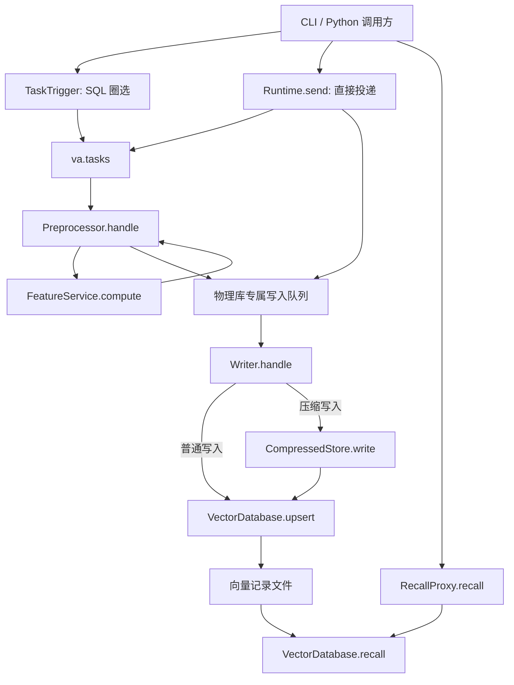

# VA 模拟系统：接口与模块调用说明

本文对应当前仓库实现，说明命令行接口、Python 接口、消息格式、模块调用顺序及错误处理。快速运行见 [README](../README.md)，验证样例见 [正确请求](../cases/correct_request.json) 和 [错误请求](../cases/invalid_request.json)。

## 1. 调用约定

系统提供两种调用方式：`python3 -m va_index ...` 命令行，以及 `va_index` 包中的 Python 对象。各服务在本地进程内执行；消息、配置、正排、压缩辅助列表和向量记录通过文件实际传递或保存。没有 HTTP/RPC 服务端；跨地区消息通过专用 MirrorTransport 传输。详见 [消费链路与地区机制](TOPOLOGY_AND_REGIONS.md)。

默认 Runtime 运行于 `va`，Namespace 为 `va_vectors`；Cluster 示例另提供独立的 MY 部署。每个地区只访问本地配置、队列和向量库，计算与压缩辅助能力只在 VA。特征计算和召回排序是模拟逻辑，但写入、读取、队列路由、消息校验和报错是真实执行的。

| 名称 | 类型与用途 |
|---|---|
| `corpusID` | Conf 中唯一的正整数；在线召回入口使用它定位索引。Python 配置对象属性名为 `corpus_id` |
| `dataset` | 非空字符串；用于将任务映射到一个或多个 corpusID |
| `feature_name` | 特征名称；同一特征可以对应多个物理库，不能据此唯一确定写入目标 |
| `db_name` | 完整物理库名；用于队列路由、落库及压缩辅助记录定位 |
| `namespace` | 向量库 Namespace；与 `db_name` 一起标识底层存储目标 |
| 业务 ID | 消息中必须是非空字符串；SQL 查询得到的整数会转成字符串 |
| `task_id` | 业务任务标识，非空字符串；同一任务重放时使用相同值，新任务应使用新值 |
| `message_id` | 一条队列消息的标识；32～64 位小写十六进制字符串，由系统生成 |
| `embedding` | 非空数值列表；元素必须是有限的整数或浮点数，不接受布尔值、NaN、Infinity |
| `mode` | `realtime` 或 `forward`，没有其他取值 |

多数调用通过 `FileConfig.snapshot()` 同时读取并校验 `tcc.json`、`conf.json`、`queues.json`。例如召回虽然不消费队列，仍会校验队列配置。不存在配置缺失时的默认回退。

Python 侧的 Runtime 目录参数可传字符串或 `pathlib.Path`。直接组装底层模块、调用文件工具时，路径参数应传 `Path` 对象；这些底层接口不统一执行字符串到路径的转换。

## 2. 默认索引、队列和调用链

### 2.1 索引与队列

| corpusID | 类型 | Feature / 维度 | 物理库 | 专属写入队列 |
|---|---|---|---|---|
| 101 | 普通 | `image_embedding` / 8 | `va_vectors_image_1001` | `va.write.image` |
| 102 | 压缩 | `image_embedding` / 8 | `va_vectors_image_comp_2002` | `va.write.image_comp` |
| 103 | 压缩 | `image_embedding` / 8 | `va_vectors_image_comp_shadow_3003` | `va.write.image_comp_shadow` |
| 104 | 普通 | `text_embedding` / 6 | `va_vectors_text_4004` | `va.write.text` |

四个索引共用入口任务队列 `va.tasks`，但各自拥有独立写入队列。

| Dataset | corpusID 集合 |
|---|---|
| `products` | 101、102、103、104 |
| `image_only` | 101、102 |
| `shadow_only` | 103 |
| `image_normal_only` | 101 |
| `image_compressed_only` | 102 |
| `text_only` | 104 |

### 2.2 模块调用链



`Runtime.process()` 从 `bindings[queue].consumer` 找到 `consumers` 中指定的服务，执行对应处理代码；不根据队列名称、消息 kind 或任务/索引角色隐式选择服务。默认绑定让任务队列进入 Preprocessor、物理库队列进入 Writer。服务需要下一跳时必须显式发布消息；运行时不会补齐未发布的下游步骤。

## 3. 命令行接口

### 3.1 全局参数、输出与退出码

```bash
python3 -m va_index [全局参数] <子命令> [子命令参数]
```

| 全局参数 | 默认值 | 说明 |
|---|---|---|
| `--config-dir` | `config` | Conf、TCC、队列和任务配置目录 |
| `--state-dir` | `state` | 运行数据目录 |
| `--fixtures-dir` | `fixtures` | 初始化业务数据和正排数据目录 |
| `--region` | `va` | 运行/操作地区 |
| `--cluster` | 未设置 | 部署清单；配置和 fixtures 目录改由清单指定，state-dir 下按地区隔离 |

全局参数必须放在子命令前。相对路径基于当前工作目录，示例默认在仓库根目录运行。

```bash
python3 -m va_index --state-dir /tmp/va-interface-example init
```

正常结果及消费失败结果以 JSON 写到标准输出。入口处捕获的 `SimulationError`、`OSError` 以 `{"error": "原因"}` 写到标准错误。命令行参数解析错误由 argparse 输出使用说明。

| 退出码 | 含义 |
|---|---|
| 0 | 命令按自身语义完成；`submit` 或 `send --enqueue-only` 的 0 仅表示入队成功 |
| 1 | 业务/配置/存储错误、消费失败、验证失败，或同步写入尚未完成 |
| 2 | 参数缺失、非法选项、命令行 JSON 解析失败等 argparse 错误 |
| 130 | 捕获到 Ctrl-C / `KeyboardInterrupt` |

### 3.2 初始化和配置检查

| 命令 | 参数 | 返回和调用规则 |
|---|---|---|
| `init` | 无 | 校验配置；缺失时创建 `business.sqlite3` 和 `forward.json`；返回 `region`、`state_dir`、`queues`。保留已有数据 |
| `validate` | 无 | 返回 `valid`、`region`、索引数量、Dataset 列表和队列列表；只校验 TCC、Conf 和队列配置，不校验 SQL 数据、正排内容或 `jobs.json` |
| `topology` | 无 | 返回实际队列 binding、消费者服务及输出路由；Cluster 模式显示所有地区 |

Cluster 模式的 init 初始化所有部署地区，validate 检查所有地区配置、Namespace/物理库身份隔离及 Mirror 目标和转发环。

使用 SQL 或正排计算之前先运行 `init`。直接投递已计算的写入消息不依赖 SQL 数据或正排文件，但仍依赖有效配置和可写状态目录。`worker`、`demo` 会自动初始化；验证器会初始化独立实验目录。

### 3.3 SQL 写入：`submit` 和 `write`

| 参数 | 是否必填 | 默认值 | 说明 |
|---|---|---|---|
| `--dataset` | 是 | — | Conf 中已存在的 Dataset |
| `--sql` | 是 | — | 单条只读查询，结果中必须恰好有一个名为 `id` 的列；可以包含其他列 |
| `--mode` | 否 | `realtime` | 特征计算方式 |
| `--limit` | 仅 `write` 可用 | 10000 | 本次最多消费的消息数，必须是正整数 |

`submit` 执行 SQL 并投递任务消息，返回 `task_id`、`message_id`、`queue`、`selected_ids`、`count`，不启动消费者。

`write` 在提交后调用 `Runtime.wait_delivery()`，推进实际消费并收集本次任务及下游消息的结果；在提交信息之外还返回 `status`、`writes`、`errors`、`deliveries`。

```bash
python3 -m va_index init
python3 -m va_index write --dataset image_normal_only --mode forward \
  --sql "SELECT id FROM business WHERE id = 'p1'"
```

SQL 查询规则：

- 实际查询 `state/business.sqlite3`，示例表为 `business(id TEXT PRIMARY KEY, category TEXT, active INTEGER)`。
- `id` 值只接受非空字符串或整数；整数转字符串，重复值保留第一次出现的位置。
- 禁止写 SQL、ATTACH 和多条语句；通过 SQLite 进度回调限制长查询，约 5 秒后中断。
- 查询为空会生成 `ids: []` 的任务；消费成功后没有向量写入。
- `SELECT 'new-id' AS id` 也可用于模拟单条业务数据；实时模式能处理它，正排模式仍要求对应正排数据存在。

### 3.4 消息投递：`send`

| 参数 | 是否必填 | 默认值 | 说明 |
|---|---|---|---|
| `--queue` | 是 | — | 已注册的任务队列或物理库专属队列 |
| `--kind` | 是 | — | `task` 或 `write` |
| `--payload` | 二选一 | — | 消息 payload 的 JSON 字符串 |
| `--payload-file` | 二选一 | — | 包含 payload 的 JSON 文件路径 |
| `--enqueue-only` | 否 | 不启用 | 只入队，返回 `status: "pending"` |
| `--limit` | 否 | 10000 | 同步模式的消费上限，必须是正整数 |

传入的是 **payload，不是完整 envelope**；消息 ID、版本、时间和尝试次数由 Broker 生成。队列是否注册在入队时检查，业务字段在消费时检查。因此 `--enqueue-only` 成功不代表 payload 已通过业务校验。

```bash
# 任务队列：后续仍会读取 Dataset、计算特征并投递写入队列
python3 -m va_index send --queue va.tasks --kind task \
  --payload-file cases/messages/text_task.json

# 写入队列：已携带向量，直接进入 Writer
python3 -m va_index send --queue va.write.image_comp_shadow --kind write \
  --payload-file cases/messages/shadow_a.json
```

默认同步消费，返回完整投递结果；仅入队时只返回 `queue`、`message_id`、`status`。Python 的 `Runtime.send()` 对应 `wait=False` 选项。

### 3.5 消费和队列管理

| 命令 | 参数与默认值 | 返回和调用规则 |
|---|---|---|
| `process` | `--stage all/preprocess/write`，默认 `all`；可选 `--queue`；`--limit 10000` | 返回 `processed`、`failed`、本次处理的 `messages` 和全部 `queues` 统计 |
| `queues` | 可选 `--queue`；`--status pending/done/failed`，默认 `pending` | 不指定 queue 时返回各队列三种状态的计数；指定后返回该队列对应状态的完整 envelope 列表 |
| `retry` | 必填 `--queue` | 将该队列所有失败消息移动回 pending，返回 `queue`、`retried`；不立即消费 |

`process --stage preprocess/write` 按队列实际绑定的 preprocessor/writer 服务筛选。指定 `--queue` 时，该队列必须属于所选阶段；forwarder、mirror 使用 all 阶段或直接指定队列。消费在队列之间轮转，每次从一个队列取一条；单队列当前按 pending 文件修改时间和文件名排序。disabled 绑定不消费。

普通 process 只处理选定地区。Cluster 模式可以增加 `--all-regions` 来轮询全部地区；该选项不能同时筛选 queue/stage。同步 write/send 在 Cluster 中也使用通用多地区队列循环，仍由实际消费者决定消息下一跳。

`process` 本次处理出现失败时退出码为 1；没有本次失败时为 0，**即使达到 limit 后仍有积压**。判断是否全部完成应查看队列计数。历史 failed 消息不会自动重试。

```bash
python3 -m va_index process --stage preprocess
python3 -m va_index queues --queue va.write.image_comp --status pending
python3 -m va_index process --stage write --queue va.write.image_comp
python3 -m va_index queues --queue va.tasks --status failed
python3 -m va_index retry --queue va.tasks
python3 -m va_index process
```

### 3.6 特征计算：`feature`

必填 `--id`、`--feature`；可选 `--mode realtime/forward`，默认 `realtime`。返回 `{"embedding": [...]}`。

```bash
python3 -m va_index feature --id p1 --feature image_embedding --mode forward
```

实时模式以业务 ID 生成模拟向量，不查询业务表。正排模式实际读取 `state/forward.json` 的 `forward[id][feature_name]`，ID 或特征字段缺失时报错。两种模式都读取 TCC 中的维度和 seed。

### 3.7 在线召回：`recall`

| 参数 | 是否必填 | 说明 |
|---|---|---|
| `--corpus-id` | 是 | 配置中的数字 corpusID |
| `--embedding` | 是 | 查询向量 JSON，维度必须与索引 Feature 一致 |
| `--top-k` | 否 | 正整数；未传入时使用配置默认值 |
| `--return-attr` / `--no-return-attr` | 否 | 显式启用/关闭 Attr；未传入时使用配置 |
| `--return-embedding` / `--no-return-embedding` | 否 | 显式启用/关闭返回向量；未传入时使用配置，缺省为 false |

优先级为：请求显式参数 > Conf 的 `extra_config.recall` > TCC 的 `recall`。当前 TCC 默认 `top_k=3`、`return_attr=false`；corpusID 102 在 Conf 中默认启用 Attr。

```bash
python3 -m va_index recall --corpus-id 101 \
  --embedding '[0,0,0,0,0,0,0,0]' --top-k 3 --return-attr --return-embedding
```

返回 `region`、`corpusID`、`namespace`、`db_name`、`mock_scores: true`、`hits`。每个 hit 包含 `id`、`score`，按选项包含 `attr`、`embedding`。配置存在但没有写入的库返回 `hits: []`；未知 corpusID、非法向量或不可读配置返回错误。

底层当前按记录 ID 排序取前 K 条，分数为模拟值。查询向量用于维度/格式检查，不参与真实相似度计算。压缩索引返回哈希记录 ID，原始业务 ID 在 Attr 中，不自动展开成多个 hit。

### 3.8 调度、检查和验证

| 命令 | 参数 | 行为与返回 |
|---|---|---|
| `tick` | 无 | 读取 `jobs.json`，提交当前到期任务，返回任务结果列表；不消费。无到期任务返回 `[]` |
| `worker` | `--poll-seconds`，默认 1，范围 0.05～3600 | 初始化后循环 `tick → process → 等待`；有调度结果或消费结果时输出 JSON，Ctrl-C 退出 |
| `dump` | 无 | 返回 `{db_name: [完整向量记录, ...]}`；记录含 `id`、`embedding`、`attr` |
| `demo` | 无 | 初始化，SQL 圈选 active 商品，以 forward 模式写入 products，然后展示数量和压缩召回 |
| `verify` | `--cases` 默认 `cases/correct_request.json`；可选 `--case <case-id>` | 在独立目录执行请求并检查实际结果，返回 `passed`、`summary`、`report_path`、`cases`；失败退出码为 1 |

`worker` 会记录消息失败并继续轮询，不会自动重试 failed 消息；配置等入口异常仍可能令进程退出。它连续输出多个完整 JSON 对象，不是一个 JSON 数组。

Cluster worker 只调度所选地区的 jobs，但推进所有地区的已绑定队列消费者。demo 是 VA 基线，MY 下会明确报错。

`demo` 使用已有状态，重复执行不是清空重建。`verify` 每次创建新的实验状态和配置副本，适合可重复验收。

## 4. 消息与回执契约

### 4.1 Broker envelope

队列文件格式如下，实际 `message_id` 会由 Broker 生成：

```json
{
  "schema_version": 1,
  "message_id": "0123456789abcdef0123456789abcdef",
  "kind": "task",
  "created_at": "2026-10-22T12:00:00+00:00",
  "attempts": 0,
  "payload": {
    "task_id": "example-task-001",
    "dataset": "image_normal_only",
    "ids": ["p1"],
    "mode": "forward"
  }
}
```

消费前检查版本必须为整数 1、消息 ID 必须与文件名相同、attempts 必须为非负整数。进入处理后 attempts 加一，并记录实际 consumer 和 region。成功文件增加 `result`，失败文件增加 `error`。文件位于 `<地区state>/queues/<queue>/<pending|done|failed>/<message_id>.json`。Mirror 保留消息身份与 payload，目标队列独立维护消费状态。

### 4.2 `task` payload

顶层必须恰好包含以下四个字段，缺字段或多字段都报错：

| 字段 | 规则 |
|---|---|
| `task_id` | 非空字符串 |
| `dataset` | 非空字符串，预处理时必须能从 Conf 解析 |
| `ids` | 字符串列表，允许空列表，不允许重复 ID |
| `mode` | `realtime` 或 `forward` |

投递到绑定了 preprocessor 的队列后，预处理按 Dataset 查询索引，再按 Feature 分组：对每个业务 ID、每个 Feature 计算一次，按消费者的 outputs 配置向下一队列分别发布写入消息。outputs 可以指向最终专属队列或中转队列，缺失时失败。

任务 ID 用于下游去重。不要把不同任务复用为相同 `task_id`，尤其不要在保留任务 ID 的情况下更换数据或配置并期望重新写入所有已有目标。

### 4.3 `write` payload

```json
{
  "id": "sample-id",
  "embedding": [0.1, 0.2, 0.3, 0.4, 0.5, 0.6, 0.7, 0.8],
  "db_list": ["va_vectors_image_comp_shadow_3003"],
  "compressed_db_list": ["va_vectors_image_comp_shadow_3003"],
  "context": {
    "task_id": "sample-write-task",
    "dataset": "shadow_only",
    "feature_name": "image_embedding",
    "mode": "realtime",
    "attr_by_db": {"va_vectors_image_comp_shadow_3003": {}}
  }
}
```

顶层必须恰好包含 `id`、`embedding`、`db_list`、`compressed_db_list`、`context`。

| 字段 | 规则 |
|---|---|
| `id` | 原始业务 ID，非空字符串 |
| `embedding` | 有限数值列表，消费时还检查目标索引维度；解析时统一转为浮点数 |
| `db_list` | 非空、无重复的物理库名称列表 |
| `compressed_db_list` | 无重复的字符串列表，允许为空，必须是 `db_list` 的子集 |
| `context.task_id` | 非空字符串 |
| `context.dataset` | 非空字符串，写入阶段作为上下文，不重新查询其索引绑定 |
| `context.feature_name` | 非空字符串，必须与目标库的 Feature 一致 |
| `context.mode` | `realtime` 或 `forward`，用于记录来源；Writer 不重新计算特征 |
| `context.attr_by_db` | 对象，键必须恰好等于 db_list 中的库名，每个值必须是对象 |

`context` 允许携带其他上下文字段。Writer 先验证所有库的路由和维度，再执行写入。

当前每个物理库对应不同队列，因此一条合法写入消息只能包含当前队列负责的那个库。需要写多个库时，应分别投递各自队列，或者发送 Dataset 任务让预处理完成分发。

**压缩分支由消息中的 `compressed_db_list` 决定。** 预处理会根据 Conf 生成它；直接投递 write 消息的调用方也必须正确填写。Writer 不会根据最新 `is_compressed` 自动修复这份列表，以保留上游已作出的决定。普通 Attr 使用 `attr_by_db[db_name]`；压缩 Attr 使用原始业务 ID 列表，忽略该库的普通 Attr 对象。

### 4.4 消费结果和同步投递结果

预处理成功时，envelope 的 `result` 是：

```json
{
  "published": [
    {"queue": "va.write.image", "message_id": "下游消息ID"}
  ]
}
```

写入成功时，`result` 是：

```json
{
  "writes": [
    {
      "namespace": "va_vectors",
      "db_name": "va_vectors_image_1001",
      "id": "p1",
      "business_id": "p1"
    }
  ]
}
```

以上为返回结构示意，不是可直接投递的输入。压缩写入中 `id` 为哈希 ID，`business_id` 仍为原始 ID。

`Runtime.send(wait=True)` / `wait_delivery()` 汇总为：

| 字段 | 含义 |
|---|---|
| `queue`、`message_id` | 本次根消息 |
| `region` | 根消息所属地区；下游 deliveries 也分别标记地区 |
| `status` | `done`、`failed` 或 `pending` |
| `writes` | 能通过完成回执追踪到的写入结果，可能为空 |
| `errors` | 关联失败消息的队列、ID、状态及错误原因 |
| `deliveries` | 根消息和可追踪下游消息的状态列表 |

状态判定优先级为 `failed > pending > done`。根任务 done 仅表示预处理成功；必须检查汇总状态才能判断下游是否也完成。

此回执不是数据库事务日志。预处理部分投递后异常时，尚未返回完整 `published`，回执可能无法列出所有已经发生的副作用。排查这类情况应同时查看队列和实际存储，不要把 `writes: []` 理解成绝对没有落盘。

## 5. Python 模块接口与调用规则

### 5.1 `runtime.py`：统一调用入口

通过 `Runtime(config_dir="config", state_dir="state", fixtures_dir="fixtures", *, region="va")` 组装服务。构造时创建/检查状态目录的 .region.json 归属，但不会自动初始化业务数据。跨地区复用同一状态目录会报错。

Runtime 及其各服务组件都公开只读 `region`。地区在构造时固定，替换配置或下游客户端不会改变本服务身份；`available` 表示该组件在本地区是否可用。默认部署全部归属 va。

| 接口 | 返回 / 规则 |
|---|---|
| `initialize()` | 初始化结果对象；默认业务和正排文件不存在时才创建 |
| `write(dataset, sql, mode="realtime", *, limit=10000)` | SQL 同步写入结果；调用 trigger，然后等待投递 |
| `send(queue, kind, payload, *, wait=True, limit=10000)` | 消息入队或同步投递结果；业务校验由消费者完成 |
| `wait_delivery(queue, message_id, *, limit=10000)` | 先确认根消息存在，再执行一轮有消费上限的 process，汇总投递状态；不是无限等待 |
| `process(stage="all", queue=None, limit=10000)` | 消费统计和各消息处理结果；捕获的消费者异常体现在结果中 |
| `dump()` | 按物理库返回全部向量记录 |
| `topology()` | 返回地区、Namespace、services（每个组件的 service/region/available），以及所有队列的绑定/服务配置 |

所有 limit 必须是正整数。同步消费可能推进其他已有积压，但投递结果只汇总本次根消息关联的链路。`wait_delivery` 不会把 failed 自动移回 pending。

`write`、`send(wait=True)`、`wait_delivery` 为控制面入口，区域服务内部调用会在新消息入队前拒绝。服务间继续处理应使用本地 Broker.publish 或 send(wait=False)，跨地区必须使用已绑定的 Mirror 消费者。

对象公开 `config`、`broker`、`features`、`vectors`、`compressed`、`trigger`、`preprocessor`、`writer`、`forwarder`、`recall`、`scheduler`。业务调用通常使用 Runtime、trigger、recall；内部对象主要供服务组合、故障注入和诊断使用。Cluster 控制面连接 transport、消费者调度及跨地区回执读取；区域服务不能调用该控制面绕过地区边界。

### 5.2 `config.py`：Conf 与 TCC

| 接口 | 返回 / 规则 |
|---|---|
| `FileConfig(directory, region="va")` | 地区配置读取器 |
| `FileConfig.snapshot()` | 重新读取三份配置，返回 `Snapshot`；任何缺失、非法类型或身份/路由不一致均报错 |
| `Snapshot.index(corpus_id)` | 按数字标识返回 `IndexConfig`；字符串形式的数字不自动转换 |
| `Snapshot.dataset(name)` | 返回 Dataset 中的 `IndexConfig` 列表，保留配置顺序 |
| `Snapshot.by_db(name)` | 按完整物理库名查找配置，不根据 Feature 或地区字符串推导 |
| `Snapshot.consumer(queue)` | 查询该队列绑定的消费者配置；未知队列报错 |

`IndexConfig` 字段为 `corpus_id`、`feature_name`、`db_name`、`namespace`、`is_compressed`、`extra_config`。`Snapshot` 字段为 `tcc`、`indexes`、`datasets`、`task_queue`、`index_queues`、`consumers`、`bindings`。

Snapshot 代表一次读取的结果，长期持有同一个对象不会自动更新；再次调用 `snapshot()` 才会看到文件变化。不同服务调用会自行重新读取，不保证整个任务使用同一个配置版本。

### 5.3 `scheduler.py`：SQL 触发器和周期调度

| 接口 | 依赖、返回和规则 |
|---|---|
| `TaskTrigger(config, broker, business_path)` | 注入配置、Broker 和业务 SQLite 路径 |
| `select_ids(sql)` | 实际执行只读 SQL，返回去重后的 `list[str]`，不入队 |
| `submit(dataset, sql, mode="realtime", *, task_id=None)` | 校验 Dataset、查询 ID、校验任务并发布到 task_queue；返回提交信息，不消费 |
| `Scheduler(jobs_path, state_path, trigger)` | 注入任务配置、调度状态文件和触发器 |
| `tick(now=None)` | 返回本次到期任务的提交结果列表；`now` 可传 Unix 秒值用于测试，默认当前时间 |

调度先校验所有 job 的结构，再尝试提交到期任务；单个任务的 `SimulationError` 写进该项 `error`，其他任务继续。调度成功的含义是“成功提交”，下游执行失败不回退调度进度。

周期任务首次启用立即提交，此后按 `last_run + interval_seconds` 判断；错过多个周期只补一次。一次性任务成功提交后不再触发。状态按 job name 保存，已完成的一次性任务仅修改 SQL 不会自动重跑；新业务任务应使用新的 name。

### 5.4 `features.py`：特征服务

`FeatureService(config, forward_path)` 提供：

```text
compute(business_id: str, feature_name: str, mode="realtime") -> list[float]
```

只允许 VA 本地调用；MY 本地计算和跨地区直接调用都报错。每次读取配置；未知 Feature、缺失正排字段、错误 mode 都报错。实时模式使用 ID 作为模拟输入，正排模式使用实际正排字段作为输入；相同 Feature、seed 和正排内容得到相同向量。没有写入向量库的副作用。

### 5.5 `broker.py`：消息队列

通过 `FileBroker(root, config)` 创建，root 通常为 `state/queues`。

| 接口 | 返回 / 规则 |
|---|---|
| `names()` | 从当前配置返回全部 bindings 中的队列，包括中转和 Mirror 队列 |
| `publish(queue, kind, payload, message_id=None)` | 验证队列存在、消息 ID 格式，写入 pending，返回消息 ID；不校验业务 payload |
| `consume_one(queue, handler, *, consumer=None)` | 在本地区上下文消费一条消息，调用 handler(envelope)；空队列返回 None，否则返回 region、consumer、queue、message_id、status 及可选 error |
| `status()` | 返回每个已注册队列的 pending/done/failed 计数 |
| `delivery(queue, message_id)` | 返回 queue、message_id、status 和完整 `message` envelope；未知消息报错 |
| `messages(queue, status="pending")` | 返回指定状态的 envelope 列表，按文件名排序，不代表消费先后顺序 |
| `retry(queue)` | 将该队列全部 failed 移回 pending，返回数量；保留消息 ID 和累计 attempts |

同一队列内已存在于 pending、done 或 failed 的 message_id 不会再次创建消息；如果 kind 或 payload 不一致则返回 ID 冲突错误。不会自动重试 failed。

队列锁覆盖一次消费及 handler 执行。handler 应返回 JSON 可序列化的结果供同步回执使用，不能在持有同一队列锁时递归消费或发布到该队列。预处理发布到其他物理库队列，符合此规则。

消费过程中捕获的普通异常写入 failed；处理前的队列/配置错误和保存状态时的文件错误仍可能向外抛出。进程中断可能留下 pending，采用至少一次处理语义，不保证恰好一次。

### 5.6 `services.py`：业务处理服务

| 类与接口 | 调用方 | 行为 / 返回 |
|---|---|---|
| `Preprocessor(config, broker, features).handle(envelope, *, outputs=None)` | 绑定 preprocessor 的队列 | 只接受 kind=task；解析 Dataset，调用特征服务，按 outputs 投递，返回 `{"published": [...]}`；不传 outputs 时读取任务队列绑定消费者的配置 |
| `Writer(config, vectors, compressed).handle(queue, envelope)` | 专属写入队列消费者 | 只接受 kind=write；验证消息与 queue 的映射，展开 db_list 后落库，返回 `{"writes": [...]}` |
| `RecallProxy(config, vectors).recall(corpus_id, embedding, *, top_k=None, return_attr=None, return_embedding=None)` | 在线查询入口 | 从 Conf 定位物理库，合并参数，调用底层召回，返回带索引身份的结果 |
| `Forwarder(broker).handle(queue, envelope, output_queue)` | 绑定 forwarder 的队列 | 向本地区已注册 output_queue 显式发布相同 kind/payload，返回 published 回执 |

直接调用 `handle` 不会产生 Broker 的 attempts、done/failed 文件和重试管理。要模拟完整链路，应通过 `Runtime.send` 或 `submit/write` 进入。

Writer 使用本地区 TCC 的部署 Namespace。普通写入使用原始业务 ID；压缩写入调用仅 VA 部署的辅助服务维护列表，再把哈希 ID 和业务 ID 列表写入同一目标库。MY 当前无法完成该压缩步骤。此阶段不调用 FeatureService，不访问正排，也不会从消息中接受覆盖 Namespace 的参数。

### 5.7 `vector_db.py`：底层向量库与压缩辅助存储

`VectorDatabase(root, config)` 的公开接口：

| 接口 | 返回 / 规则 |
|---|---|
| `upsert(namespace, db_name, id, embedding, attr)` | 成功返回 `None`；按记录 ID 覆盖写，真实落盘；校验 Namespace、物理库、ID 和向量维度 |
| `records(namespace, db_name)` | 返回按记录 ID 排序的完整记录列表；配置中的空库返回 `[]` |
| `recall(namespace, db_name, embedding, top_k=3, return_attr=False, return_embedding=False)` | 返回 hit 列表；不带代理层的 corpusID/库身份外层对象；真实读取该库记录 |

直接调用底层 `recall` 使用函数参数默认值，不合并 TCC/Conf 的召回默认参数。业务查询应经过 `RecallProxy`。直接调用 upsert 不经过消息队列，也不自动处理压缩索引。

`CompressedStore(root, region="va")` 的公开接口（仅 VA 本地可用）：

| 接口 | 返回 / 规则 |
|---|---|
| `write(db_name, business_id, embedding, upsert)` | 计算哈希，实际读取/更新列表，调用 `upsert(hash_id, ids)` 回调，返回 hash_id |
| `lookup(db_name, hash_id)` | 实际读取指定物理库的原始 ID 列表，不存在时返回 `[]` |

压缩辅助服务只以 `db_name + hash_id` 为键，不使用 Feature 或 corpusID 定位。它不独立解析 Conf；调用方负责提供有效物理库和业务 ID。回调在该库的文件锁内执行，不应递归调用同库的辅助接口。

ID 列表先保存，再执行向量写入回调。回调失败时列表可能已经更新，下一次重试读取已有列表继续落库。列表只追加并去重，不删除旧映射；某个业务 ID 更换向量时不自动清理它在旧哈希下的归属。

### 5.8 `messages.py`：消息边界校验

| 接口 | 作用 |
|---|---|
| `TaskMessage.parse(raw)` | 严格检查 task 顶层字段与基础类型，返回 TaskMessage；不查询 Dataset 是否存在 |
| `WriteMessage.parse(raw)` | 严格检查 write 顶层字段、列表关系和上下文，规范化向量，返回 WriteMessage；不查询物理路由 |
| `TaskMessage.payload()` / `WriteMessage.payload()` | 转为可发布的字典；本身不重新校验 |
| `fields(value, required, name)` | 检查对象的字段集合恰好等于 required |
| `string_list(value, name, *, nonempty=True)` | 检查字符串列表，拒绝重复值 |
| `embedding_value(value)` | 检查非空、有限数值向量，转为浮点列表，并统一正负零 |

直接构造 dataclass 不会自动调用 parse。跨服务入口应调用 parse；生产端也可在发布前主动校验，但消费者仍保留边界校验。

### 5.9 `storage.py`：文件和通用校验

| 接口 | 规则 |
|---|---|
| `read_json(path)` | 使用 UTF-8 读取 JSON；读取或解析错误包装为 SimulationError |
| `write_json(path, value)` | 创建父目录、写临时文件、刷新并原子替换目标文件；拒绝 NaN/Infinity |
| `file_lock(path)` | 上下文管理器，使用独占文件锁；读改写操作由调用方包裹 |
| `stable_hash(value)` | 对规范 JSON 表达计算 SHA-256，返回十六进制字符串 |
| `object_value(value, name)` | 要求字典并原样返回 |
| `text_value(value, name)` | 要求非空且非纯空白字符串并原样返回；不自动 trim |
| `positive_int(value, name)` | 要求正整数，拒绝布尔值 |
| `SimulationError` | ValueError 子类，表示可解释的配置、请求或模拟服务错误 |

`write_json` 只保证单文件替换完整性，不提供跨文件事务，也不自动加锁。队列、压缩列表和向量服务分别管理自己的锁。以 `_` 开头的方法为实现内部辅助方法，不作为外部调用契约。

### 5.10 `verification.py`：验收调用

| 接口 | 规则 |
|---|---|
| `verify(runtime, cases_path=Path("cases/correct_request.json"), *, case_id=None, cluster=None)` | 读取 case，创建独立实验目录，调用实际 API，保存并返回报告；Cluster 模式传入 cluster，会复制所有地区的配置并接入 Mirror |
| `verify_request(runtime, request, directory=Path("."), *, cluster=None)` | 在当前状态执行一条请求并核对实际结果，不创建隔离副本；返回 input、passed、实际 response，以及成功的 checks/evidence 或失败的 error；捕捉请求和验证异常，不自动回滚 |
| `verify_storage(runtime, expectations, *, cluster=None)` | 直接读取当前落盘文件，核对指定库完整业务 ID 集合、记录数及可选分组；成功返回证据列表，不符合预期时抛 VerificationFailure，格式错误抛 SimulationError |
| `execute(runtime, request, directory)` | 根据 request.op 调用 write、send 或 recall；directory 为 payload 文件相对路径基准 |
| `request_payload(request, directory)` | 从 payload_file 读取或使用内嵌 payload；有文件字段时优先读文件 |
| `read_persisted(state)` | 独立读取向量文件，返回以 `(namespace, db_name)` 为键的记录映射，不使用消费者回执判断落盘 |
| `verify_target(runtime, target, case, case_directory)` | 旧版 schema 1 使用：核对业务 ID、物理库和记录数，重建服务后召回，核对返回记录确实存在 |
| `check(condition, message)` | 条件不满足时抛出 VerificationFailure |
| `VerificationFailure` | AssertionError 子类；单 case 失败会写入报告，不阻止其余 case |

`verify` 和 `verify_request` 都属于控制面接口。传入已连接 Cluster 的 Runtime 时，还须传入对应 cluster，避免丢失 Mirror 或漏查目标地区存储。业务队列仍仅由原有绑定消费者推进。case 格式见第 8 节。

### 5.11 命令入口模块

`cli.py` 的 `parser()` 构造参数解析器，`main(argv=None)` 执行命令并返回退出码，`emit(value)` 输出 JSON。`__main__.py` 调用 `main()` 并以其返回值退出进程。`__init__.py` 为包入口，不额外提供服务接口。

### 5.12 地区与多地区控制面模块

`regions.py` 提供 `RegionalService` 基类（只读 region/available）、`region_scope` 地区上下文、`local_service` 服务入口装饰器、`require_local`/`require_va` 访问检查、`require_control_plane` 控制面调用检查、`region_name` 地区名检查、`claim_state` 状态目录归属登记和 `require_state_path` 资源路径归属检查。地区名称是以小写字母开头、由小写字母、数字、下划线或连字符组成的 1～32 位字符串。

`local_service` 先验证调用方和服务地区一致，再建立该服务的上下文；va_only 服务只在 VA 可用。异常不会被装饰器吞掉，队列消费异常由 Broker 保存到 failed。`require_state_path` 检查路径解析后的最近一层 .region.json，防止把另一个地区的状态路径误接给本地资源 API；没有归属标记的独立组件/fixture 路径仍可使用。Runtime 始终先登记状态归属再创建组件。只有 MirrorTransport 使用内部跨地区交接上下文，消息正文中的地区字段不能授权跨区访问。

`cluster.py` 的 `Cluster` 创建各地区 Runtime，连接 MirrorTransport，提供 runtime、validate、initialize、process、delivery、topology 控制面接口。它仅轮询已配置消费者，不包含迁移业务流程。MirrorTransport.copy 只复制消息，不能访问其他地区的特征计算或压缩服务。详细参数、部署清单和可执行示例见 [地区机制文档](TOPOLOGY_AND_REGIONS.md)。

## 6. 配置文件调用规则

### 6.1 `config/tcc.json`

| 字段 | 规则 |
|---|---|
| `region` | 必须与 Runtime.region 一致，默认部署为 va |
| `namespace` | 非空字符串；所有 Conf 索引必须使用该 Namespace |
| `features` | Feature 名到配置的对象映射 |
| `features.<name>.dimension` | 正整数，写入和召回时按此校验维度 |
| `features.<name>.seed` | 非空字符串，控制模拟向量生成 |
| `recall.top_k` | 必填正整数 |
| `recall.return_attr` | 必填布尔值 |
| `recall.return_embedding` | 可选布尔值；省略时底层默认 false |

### 6.2 `config/conf.json`

顶层 region 必须与 Runtime.region 一致，indexes 为非空列表，datasets 为对象。

索引必填 `corpusID`、`feature_name`、`db_name`、`namespace`、`is_compressed`；`extra_config` 可省略，默认 `{}`。corpusID 为唯一正整数，db_name 也必须唯一。Feature 必须已存在于 TCC，is_compressed 必须为布尔值。

`extra_config.attr` 是普通写入对象。`extra_config.recall` 只支持 `top_k`、`return_attr`、`return_embedding`，分别满足正整数和布尔类型规则。`datasets.<name>` 为非空且不重复的已存在 corpusID 列表。

### 6.3 `config/queues.json`

region 必须与 Runtime.region 一致；task_queue 为 SQL 入口队列名；index_queues 是完整 db_name 到最终专属写入队列名的映射。其键集合必须与全部 Conf 物理库集合完全一致，不得遗漏或额外配置未定义的库。

所有队列名必须互不相同，包括任务队列。允许字符为英文字母、数字、下划线、点和连字符，首字符必须是字母或数字，长度 1～128。服务不把任意队列名当作新队列自动注册；配置中存在后才会按需创建对应状态目录。

必须提供 consumers 和 bindings；每个已注册队列恰好绑定一个已定义消费者，可以 enabled=false 暂停消费。preprocessor 的 outputs 定义物理库到下一跳队列，forwarder 的 output_queue 定义本地中转目标，mirror 的 target_region/target_queue 定义跨地区复制目标。中转队列也必须显式注册。服务类型、示例及转发环约束见 [地区机制文档](TOPOLOGY_AND_REGIONS.md)。

每条 consumer/binding 可声明 region，省略时继承文件顶层 region；显式值必须与运行地区相同。Snapshot 返回的 consumer/binding 均含归属地区。此字段不能用于跨地区绑定；Mirror 的 target_region 才表示消息复制目标。

### 6.4 `config/jobs.json`

顶层 `region` 必须与 Scheduler.region 相同，旧文件省略时默认 va。顶层 `jobs` 为列表，每个 job 包含：

| 字段 | 规则 |
|---|---|
| `name` | 唯一非空字符串，也是调度状态键 |
| `enabled` | 布尔值；false 时不提交，但仍检查配置结构 |
| `kind` | `once` 或 `periodic` |
| `interval_seconds` | periodic 必填正整数；once 不需要 |
| `dataset` | 非空字符串，在实际提交时检查是否存在 |
| `mode` | `realtime` 或 `forward` |
| `sql` | 非空字符串，在实际提交时执行并校验 |

此文件仅由调度相关调用读取；常规写入和召回不会读取 jobs。默认 `active-products` 每 3600 秒提交 products 的 forward 任务；`initial-images` 是默认关闭的一次性任务。

### 6.5 修改配置与运行数据

新增 VA 索引需要一起更新 Conf 索引、Dataset、index_queues、最终队列 binding 和预处理消费者 outputs；新增 Feature 还需更新 TCC，正排模式还需准备运行时正排字段。修改后先运行 validate，再恢复消费。

配置文件逐次读取，但没有跨文件事务、任务级配置快照或历史版本选择。涉及维度、Namespace、物理库名或队列名称调整时，应先处理旧消息；删除队列配置不会自动迁移旧目录中的消息。

`fixtures/` 仅用于初始化。之后修改业务输入应操作对应状态目录中的业务 SQLite 或 `forward.json`。每个实验使用不同 `--state-dir` 可以保留独立环境。

## 7. 错误处理、持久化与重试

| 场景 | 发生阶段 | 调用方应如何判断 |
|---|---|---|
| 队列不存在、配置缺失或配置不一致 | 入队或服务配置读取 | Python 抛出异常；CLI 通常返回 stderr.error 和退出码 1 |
| 跨地区服务调用、配置/状态目录归属错误、调用本地区未部署的能力 | 服务入口、配置读取或资源访问 | 链路直接抛 SimulationError；在队列内则保存 failed，同步入口返回 failed/errors，CLI 退出码 1；不依赖验证器 |
| SQL 无效、ID 列缺失、业务库未初始化 | TaskTrigger | 不生成本次任务消息，返回入口错误 |
| 消息字段错误、kind 错误 | 消费者 | 消息进入 failed；同步入口返回 failed/errors；仅入队时需消费后才发现 |
| 写入消息投错队列、Feature 不符、维度错误 | Writer 校验 | 当前消息失败，不进入其最终写入步骤 |
| 正排缺失 | 预处理计算 | 当前任务失败；此前已分发的其他 ID/Feature 消息可能仍存在 |
| 辅助列表保存成功、最终向量写失败 | 压缩写入 | 当前写入消息失败，辅助列表可能已改变；修复后重试 |
| 达到同步消费 limit | Runtime | 返回 pending，不能视作落库成功，也不代表消费者报错 |
| 已配置库没有数据 | 召回 | 返回空 hits，属于正常结果 |

重试操作：先修复故障，再 `retry --queue <队列>`，然后 `process`。重复执行 retry 不会更换消息 ID；失败消息中的旧 error 在成功消费后会移除。

普通向量按记录 ID upsert。压缩列表对原始业务 ID 去重。预处理对 `(task_id, business_id, db_name)` 生成稳定下游消息 ID，使相同任务重放不会再次发布已有消息；保留 done 文件是该去重的一部分。

各文件的作用：

| 路径（相对 state_dir） | 内容 / 定位规则 |
|---|---|
| `business.sqlite3` | SQL 圈选数据 |
| `.region.json` | 该状态目录的地区归属 |
| `forward.json` | 业务 ID → Feature → 正排字段 |
| `scheduler.json` | job name → last_run、runs |
| `queues/<queue>/<status>/*.json` | 原始 envelope、消费结果或错误 |
| `vectors/*.json` | 每个 Namespace + db_name 一份文件；内部包含 namespace、db_name、按记录 ID 索引的 records |
| `compressed/*.json` | 每个 db_name 一份文件；内部包含 db_name 和 hash_id → 原始 ID 列表 |
| `verification/<run-id>/report.json` | 验收报告及各 case 的实际响应 |

文件名哈希仅用于路径编码，文件内部仍保存完整库身份。不要通过文件名替换地区字符串来推导逻辑目标。多文件更新和多目标写入没有回滚事务；失败检查应结合回执、队列和存储。

## 8. 验证器调用与 case 扩展

```bash
# 默认正确请求 case：退出码 0
python3 -m va_index verify --cases cases/correct_request.json
# 错误请求 case：passed=false，退出码 1
python3 -m va_index verify --cases cases/invalid_request.json
```

### 8.1 schema 2：按请求结果判定

顶层为 `{"schema_version": 2, "cases": [...]}`。每个 case 接受 `id`、可选 `description`、非空 `requests`，以及可选 `expect_storage`。id 唯一，只含小写字母、数字和下划线。不支持 `expect_error`：任何请求错误都判失败。

| op | 参数和调用规则 |
|---|---|
| `sql` | 必填 dataset、sql；可选 mode（默认 realtime）、limit（默认 10000）、expected_ids、target_region。执行 Runtime.write |
| `send` | 必填 queue、kind；payload 与 payload_file 必须二选一；可选 limit、target_region。文件路径相对 case 文件目录；执行 Runtime.send，等待实际消费 |
| `recall` | 必填 corpusID、embedding；可选 top_k、return_attr、return_embedding。执行 RecallProxy；默认显式请求 Attr 和向量以便核对，允许设 false 或 null（使用配置） |

所有请求还可使用 `region`，默认 Runtime 所在地区。在 Cluster 模式下它选择请求入口，不绕过地区隔离。task/SQL 的 `target_region` 指定预期落库地区，默认与入口相同；直接 write 按 payload.db_list 在部署配置中定位所属地区，若指定 target_region 则额外核对。选择目标地区只影响验证预期，不改变消费者路由或消息正文。

每条请求立即验证；一个 case 的后续请求不能掩盖前面未落盘的写入。该 case 失败后停止执行，继续下一个 case。检查如下：

1. 捕捉真实异常与 error/errors；写入回执必须为 done，failed 或 pending 均失败。
2. SQL 的预期业务 ID 来自入口的 selected_ids；可用 expected_ids（允许空列表）额外核对集合。task 使用 payload.ids；直接 write 使用 payload.id 和 db_list。目标库来自 Conf，压缩决策分别来自 Conf 或直接 write 的 compressed_db_list，不使用消费者 writes 回执证明落盘。
3. 独立读取向量文件，确认预期业务 ID 存在，向量有限且维度正确；压缩索引通过 Attr 中的业务 ID 核对。直接 write 还要求存储向量与输入相同；普通 Attr 与请求/Conf 一致。其他物理库应保持原样。
4. 召回定位必须符合请求的 corpusID、地区、Namespace 和物理库。每个 hit 必须存在于**召回前**的存储，不能重复，返回向量和 Attr 必须与文件一致，数量不超过有效 top_k。召回不能修改存储；非空库不能返回空结果，空库允许空结果。

验证器支持多库写入、空选集、独立召回和现有 Mirror。它不规定模型输出、向量哈希、相似度分数、排序或固定消费跳数，也不会替链路补发消息。SQL/任务写入主要验证业务 ID 是否入库；若需验证具体更新向量，用直接 write 请求。故障时可能已经部分落盘，不自动回滚。

报告包含总计、每个 case 的 passed/error、每步 input/response/passed/checks/evidence/error，以及报告路径。每个 case 使用全新配置副本和状态，SQL/正排从 fixtures 初始化；不复用原业务环境的数据。Cluster 模式同时复制各地区配置并保留 Mirror，报告中 state_dir 下按地区分目录。

`expect_storage` 是可选的最终状态断言列表，在该 case 的全部请求通过后执行。例如，要求 MY 的 102 压缩库包含三个业务 ID、合并为两个向量：

```json
"expect_storage": [
  {"region": "my", "corpusID": 102, "business_ids": ["p1", "p2", "p3"],
   "record_count": 2, "id_groups": [["p1", "p2"], ["p3"]]}
]
```

每项必填 corpusID、business_ids（允许空列表）和非负整数 record_count；region 默认 Runtime 所在地区。业务 ID 必须与该库中实际 ID 集合完全一致，数量为向量记录数，不能用业务 ID 数代替压缩记录数。

可选 id_groups 表示每条向量所对应的原始 ID 集合，忽略组顺序和组内顺序。普通库每组只有记录自身的 ID；压缩库从 Attr 读取分组，并拒绝重复列表元素。id_groups 条目数必须等于 record_count，覆盖集合必须恰好等于 business_ids。它不要求具体哈希字符串或向量值。成功证据写入 case.storage_evidence；断言失败时即使请求都返回成功，该 case 也判失败。

若需验证当前状态，使用 Python 接口（先初始化 Runtime；存在 Cluster 时同时传 cluster）：

```python
from va_index.runtime import Runtime
from va_index.verification import check, verify_request

app = Runtime(state_dir="state/request-check")
app.initialize()
result = verify_request(app, {
    "op": "sql", "dataset": "image_normal_only",
    "sql": "SELECT 'p1' AS id", "expected_ids": ["p1"],
})
check(result["passed"], result.get("error"))  # 需要异常形式时显式抛出
result = verify_request(app, {"op": "recall", "corpusID": 101, "embedding": [0] * 8})
check(result["passed"], result.get("error"))
```

### 8.2 schema 1：旧版系统回归验收

[va_cases.json](../cases/va_cases.json) 保留原有 10 项系统测试，通过 `verify --cases cases/va_cases.json` 运行。该版本的 `expect_error: true` 检查系统是否正确拒绝请求，因此请求报错可以使**回归测试**通过。新请求评测请用 schema 2。

schema 1 顶层为 schema_version、indexes、cases。indexes 声明 corpusID、namespace、db_name、feature_name、is_compressed、queue。正向 case 指定 target、expected_ids、expected_record_count，限制单目标库并自动追加召回核验；负向 case 使用 expect_error，且仅有一条请求。可选 fault=missing_tcc 只删除实验副本中的 TCC。该版本不支持 Cluster；正向显式召回和多库 case 请使用 schema 2。

## 9. Python 端到端示例

下面示例使用临时状态目录，执行真实 SQL 写入、在线召回、异步消息投递和后续消费，不修改默认业务状态。请在仓库根目录运行。

```python
from pathlib import Path
from tempfile import TemporaryDirectory

from va_index.runtime import Runtime
from va_index.storage import SimulationError, read_json

with TemporaryDirectory(prefix="va-interface-") as state_dir:
    app = Runtime("config", state_dir, "fixtures")
    app.initialize()

    result = app.write(
        "image_normal_only",
        "SELECT id FROM business WHERE id = 'p1'",
        "forward",
    )
    assert result["status"] == "done", result

    recalled = app.recall.recall(
        101, [0.0] * 8, top_k=3, return_attr=True, return_embedding=True
    )
    assert recalled["hits"]
    assert recalled["hits"][0]["id"] == "p1"

    payload = read_json(Path("cases/messages/shadow_a.json"))
    queued = app.send("va.write.image_comp_shadow", "write", payload, wait=False)
    assert queued["status"] == "pending"
    completed = app.wait_delivery(queued["queue"], queued["message_id"])
    assert completed["status"] == "done", completed

    bad_message = app.send("va.write.image", "write", {"id": "bad"})
    assert bad_message["status"] == "failed"
    assert bad_message["errors"]

    try:
        app.send("missing.queue", "write", {})
    except SimulationError as error:
        print("入口错误:", error)

    print("召回:", recalled)
    print("各库记录:", app.dump())
```

调用方需要同时处理两种失败形式：入口异常，以及已经消费后返回的 `status: "failed"`。异步入口还需要继续消费或查询投递状态；入队成功本身不代表数据已经写入。
